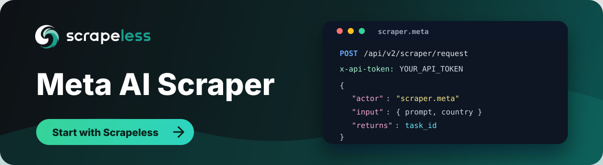

# Meta AI Scraper

<p align="center">
  <a href="https://app.scrapeless.com/passport/login?redirect=/quick-start&utm_source=github&utm_medium=repo&utm_campaign=meta_ai_scraper" target="_blank">
    
  </a>
</p>

<p align="center">
  <a href="https://app.scrapeless.com/passport/login?redirect=/quick-start&utm_source=github&utm_medium=repo&utm_campaign=meta_ai_scraper">
    
  </a>
  <a href="https://www.scrapeless.com/en/blog?utm_source=github&utm_medium=repo&utm_campaign=meta_ai_scraper">
    
  </a>
  <a href="https://x.com/Scrapelessteam">
    
  </a>
  <a href="https://www.linkedin.com/company/scrapeless/">
    
  </a>
</p>

Collect Meta AI answers through the **Scrapeless AI Scraper** API. Retrieve the answer in Markdown along with its references, conversation details, and the search steps reported for the query.

Use this repo to see which pages Meta AI cites in its final answer and which pages appear during its search.

- **Full documentation:** https://docs.scrapeless.com/en/docs/ai-scraper/scrapers/meta-ai/
- **Get your `x-api-token`:** https://app.scrapeless.com/passport/login?redirect=/quick-start
- **API endpoint:** `POST https://api.scrapeless.com/api/v2/scraper/request`

## How it works

Submit your prompt to `scraper.meta`, then use the returned `task_id` to fetch the answer. The commands below use curl and jq.

**Quick start**

Set `SCRAPELESS_API_TOKEN` to your dashboard token in the current shell. Submit the request and save the task ID.

```bash
export SCRAPELESS_API_TOKEN="your_api_token"

TASK_ID=$(curl --fail-with-body -sS 'https://api.scrapeless.com/api/v2/scraper/request' \
  -H "x-api-token: $SCRAPELESS_API_TOKEN" \
  -H 'Content-Type: application/json' \
  --data '{
    "actor": "scraper.meta",
    "input": {
      "prompt": "Which public museums in Chicago have architecture exhibits?",
      "country": "US"
    }
  }' | jq -er '.task_id')
```

**Request parameters**

| Input field | Type | Required | Description |
| --- | --- | --- | --- |
| `prompt` | string | Yes | Question to send to Meta AI. |
| `country` | string | Yes | Country code, for example `US`. |

**Retrieve the result**

Run the following command with the task ID from the first step. If the status is `pending` or `running`, wait a few seconds and repeat this GET request. On `success`, it prints the Markdown answer. On `failed`, it shows the error message.

```bash
curl -sS "https://api.scrapeless.com/api/v2/scraper/result/$TASK_ID" \
  -H "x-api-token: $SCRAPELESS_API_TOKEN" \
  | jq -r 'if .status == "success" then .task_result.full_response else {status, message} end'
```

**Response fields**

Read the following fields from `task_result` after the task succeeds.

| Field | Description |
| --- | --- |
| `user_query` | Original query. |
| `full_response` | Answer formatted as Markdown. |
| `raw_response` | Raw answer content. |
| `references` | Cited pages with titles, URLs and citation counts. |
| `conversation` | Conversation ID, response ID, title and creation time. |
| `search_engine` | Search engine used for the query. |
| `search_steps` | Reported search steps, each with a title and associated sources. |

**Code examples**

Set `SCRAPELESS_API_TOKEN` as shown above, then choose one language. Run the command without arguments to submit the sample question and print a task ID. To check that task, append the ID to the same command (for example, `python3 examples/example.py YOUR_TASK_ID`). If it prints `pending` or `running`, repeat the command **with the same ID**.

On success the example prints `full_response`, followed by the title and URL of each entry in `references` when available.

| Language | File | Run from the repository root |
| --- | --- | --- |
| Python 3 | [example.py](./examples/example.py) | `python3 examples/example.py` |
| Node.js 18+ | [example.js](./examples/example.js) | `node examples/example.js` |
| Go | [example.go](./examples/example.go) | `go run examples/example.go` |
| Java 17+ with jq | [Example.java](./examples/Example.java) | `java examples/Example.java` |
| PHP 8+ with HTTPS streams | [example.php](./examples/example.php) | `php examples/example.php` |

## Practical use cases

### AI answer monitoring

Repeat the same question over time. Save `full_response` with the response ID so an editor can trace a changed recommendation back to the answer.

### GEO and SEO research

Compare the URLs in `references` across countries. Inspect `search_steps` to see which other pages appeared during the search.

### Competitor intelligence

Ask the same feature question about two products. Compare the claims in each answer and inspect the references Meta AI cites for each product.

### Dataset and workflow automation

Store the Markdown answer with its conversation and response IDs. Index the URLs from each search step separately from the final citations.

## Why use Scrapeless for Meta AI scraping?

| Benefit | What it means for your team |
| ------- | --------------------------- |
| One unified API | Query Meta AI through the same Scrapeless AI Scraper workflow used for other AI answer engines. |
| Structured output | Read the answer, final citations and search-step sources as separate fields. |
| Less maintenance | Avoid browser automation, UI selectors, proxy rotation, retries, and anti-blocking logic. |
| Region-aware analysis | Compare localized AI answers and source citations with country-level input. |
| Production integration | Fetch results by task ID or receive completed tasks at an HTTPS webhook. |

## FAQ

### What is Meta AI Scraper?

Meta AI Scraper is a Scrapeless AI Scraper actor that sends prompts to Meta AI and returns structured answer data.

### Do I need to run a browser or proxy pool?

No. This repo shows how to call the Scrapeless API. Scrapeless handles the scraping workflow behind the API.

### Which modes or options are supported?

Supply `prompt` and `country`. For brand comparisons, ask a specific feature question. Meta AI can reject prompts that combine “best” with a brand name.

### Can I get results asynchronously?

Yes. Add `"webhook": {"url": "https://your-domain.example/callback"}` alongside `actor` and `input`, using your own HTTPS endpoint. Scrapeless sends the final status and task ID to that endpoint, together with the result on success.

### Is this suitable for AI search visibility monitoring?

Yes. Compare the URLs in `references` across runs to track whether Meta AI cites your pages. Use `full_response` to see how it describes them.

## Learn more

- [Scrapeless AI Scraper documentation](https://docs.scrapeless.com/en/docs/ai-scraper/scrapers/meta-ai/)
- [Scrapeless dashboard](https://app.scrapeless.com/passport/login?redirect=/quick-start)
- [Scrapeless blog](https://www.scrapeless.com/en/blog)

## Contact us

Need help building a Meta AI monitoring workflow or scaling AI answer collection?

- Join our [Discord](https://discord.gg/VU2vtbq7Q2).
- Contact us on [Telegram](https://t.me/scrapeless).
- For repo-specific issues or improvements, open an issue or pull request in this repository.
